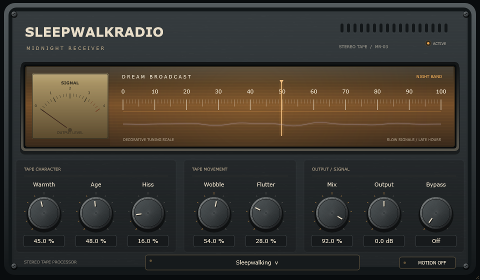

# SleepwalkRadio

Windows VST3 tape effect with saturation, wow and flutter, wear, hiss, and factory presets, built with C++ and JUCE.

## Overview

Dreamy tape coloration in the Midnight Receiver interface: compensated saturation, organic wow/flutter, worn tone, colored hiss and aligned dry/wet blending. The panel retains eight knobs. To keep it simple, **Age also controls transient blur and irregular dropouts**, and **Wobble adds gentle stereo amplitude drift**. Zero character settings remain exactly neutral after the reported delay.

## Features

- Add compensated saturation, wow, flutter, and colored hiss.
- Use Age for worn tone, transient blur, and irregular dropouts.
- Blend processed and time-aligned dry audio.
- Choose twelve factory voices plus neutral Init.
- Restore edited parameter values and preset identity in host sessions.
- Operate knobs with mouse, keyboard, or text entry.

## Screenshots



Existing offscreen editor render; this is not evidence of native DAW validation.

## Technologies

C++17, JUCE 8.0.12, VST3, CMake, MSVC, and Inno Setup.

## Getting Started

Download the [Windows x64 version 1.1.0 release](https://github.com/scryingorb/SleepwalkRadio/releases/tag/v1.1.0). Run `SleepwalkRadio-1.1.0-Windows-x64-Setup.exe`, or extract `SleepwalkRadio-1.1.0-Windows-x64-VST3.zip` and copy the complete `SleepwalkRadio.vst3` bundle to `C:\Program Files\Common Files\VST3`. Close your DAW first, then rescan its plugins. The release also provides corresponding source and checksums. See [release notes](RELEASE_NOTES.md).

### Build or run from source

- Windows 10 or newer, x64.
- Visual Studio 2019 16.11 Build Tools (or a compatible newer Visual Studio), with Desktop development with C++, MSVC v142, and Windows SDK 10.0.19041.0 or newer.
- CMake 3.22 or newer; verified setup uses 3.31.6. C++17 is required.
- Git and network access for first dependency download. Python is optional, used below to install a project-local CMake.
- JUCE 8.0.12, pinned to commit `29396c22c93392d6738e021b83196283d6e4d850` in CMake. No moving branch is used.

From the project root in PowerShell, with CMake on PATH:

```powershell
cmake -S . -B build -G "Visual Studio 16 2019" -A x64
cmake --build build --config Release --parallel 4
ctest --test-dir build -C Release --output-on-failure
```

For Visual Studio 2022, use `-G "Visual Studio 17 2022"` in a fresh build directory. It has not been tested here. CMake downloads the pinned JUCE commit into the build tree by default. For an offline configuration, supply an existing checkout of that exact commit using `-DFETCHCONTENT_SOURCE_DIR_JUCE="C:/path/to/JUCE"`.

Exact setup used on this machine (the bundled CMake 3.20 is too old):

```powershell
python -m pip install --target .tools/cmake-python cmake==3.31.6
git clone --depth 1 --branch 8.0.12 https://github.com/juce-framework/JUCE.git .deps/JUCE
git -C .deps/JUCE rev-parse HEAD
$cmake = ".\.tools\cmake-python\cmake\data\bin\cmake.exe"
$ctest = ".\.tools\cmake-python\cmake\data\bin\ctest.exe"
& $cmake -S . -B build -G "Visual Studio 16 2019" -A x64 -DFETCHCONTENT_SOURCE_DIR_JUCE="$pwd/.deps/JUCE"
& $cmake --build build --config Release --parallel 4
& $ctest --test-dir build -C Release --output-on-failure
```

Verify the printed JUCE commit matches the pin above. Dependencies, tools, build outputs, and binaries are ignored; do not commit them.

## Usage

Requires Windows 10 or newer, x64, and an x64 VST3-compatible DAW. Close your DAW and copy the entire compiled `build/SleepwalkRadio_artefacts/Release/VST3/SleepwalkRadio.vst3` bundle into `C:\Program Files\Common Files\VST3`, replacing the prior SleepwalkRadio bundle. Administrator rights are required. Rescan or restart the host. No Python, JUCE, CMake or Visual Studio is required to use it; the runtime is statically linked.

Version 1.1.0 is published with an installer, portable VST3 ZIP, corresponding source, and checksums. See [release notes](RELEASE_NOTES.md) for outstanding validation. Historical 1.0.0-rc.1 packages do not contain Dream Transmission.

Use Warmth for density, Wobble for slow irregular pitch and stereo drift, Flutter for faster instability, and Age for progressively worn/blurred/damaged tape. Hiss remains independently controlled. Mix blends with aligned dry audio; Output applies even at Mix zero. Bypass On restores aligned unity dry. Shift-drag is fine adjustment, double-click resets, and clicking a value opens text entry. Tab/arrow keys operate knobs; Space toggles Bypass. Motion Off affects visuals only.

**Latency is now 1201 samples (25.02 ms) at 48 kHz**, providing headroom for much deeper tape motion. Hosts should compensate automatically. Existing IDs/defaults/schema-1 states remain readable, but old nonneutral settings intentionally sound different with the new DSP. Re-render old projects deliberately; retain the earlier binary if exact historical sound is needed.

## Factory voices

The footer selector offers neutral Init and twelve intentionally configured voices:

| Preset | Direction |
|---|---|
| Warm Memories | Subtle warmth and gentle wear |
| Midnight Radio | Distant, dark vintage texture |
| Melted Cassette | Deep pitch warp |
| Dream Sequence | Floating, diffused movement |
| Broken Walkman | Frequent wear and fast instability |
| VHS Sunset | Warm, moderately unstable color |
| Underwater | Maximum dark blur, no added hiss |
| Ghost Transmission | Distant movement and noise |
| Old Photograph | Restrained nostalgic warmth |
| Lost Signal | Extreme pitch and deterioration |
| Analog Heaven | Strong saturation with light wear |
| Sleepwalking | Signature balance of drift, blur and warmth |

An asterisk marks edits to the selected voice, including host automation. Selecting a preset updates all eight APVTS parameters with UI automation gestures. Hosts see Init plus twelve programs. Sessions save the preset identity **and actual edited values**; reopening never reapplies factory values over saved edits. Loading a preset intentionally changes the current sound. Existing states without preset metadata display Init with an asterisk when nonneutral. Factory values are in `Source/FactoryPresets.h`; subjective voicing still needs human listening.

## Troubleshooting

- Missing plugin: use an x64 VST3 host and copy the complete bundle, then rescan/restart.
- File replacement denied: close applications using SleepwalkRadio and approve administrator access.
- Default sounds unchanged: intentional; raise character controls and verify Bypass Off / Mix above zero.
- Delay: enable host delay compensation; this is not a zero-latency monitoring effect.
- Output clipping: reduce Output/input gain. Positive Output can exceed full scale; this is not a mastering limiter.
- Preset name has an asterisk: values differ from that factory voice. Saved edits are retained on recall.
- Old sessions sound different: mappings and latency changed intentionally; parameter compatibility does not mean sonic identity.
- Native DAW/mouse/DPI behavior and listening quality remain separate manual checks. No new host validation pass is claimed.

## Run and test

Standalone application:

```powershell
& ".\build\SleepwalkRadio_artefacts\Release\Standalone\SleepwalkRadio.exe"
```

Choose the desired audio device and input in its audio settings. JUCE's standalone wrapper can mute input initially to avoid feedback; enable input deliberately with a suitable routing/headphone setup. Actual audio-device playback and listening are separate manual checks.

VST3 bundle:

```text
build/SleepwalkRadio_artefacts/Release/VST3/SleepwalkRadio.vst3
```

Add the parent VST3 directory to your DAW's scan paths, or copy the **whole .vst3 folder** to `%CommonProgramFiles%\VST3` (may require administrator permission). Rescan, then insert SleepwalkRadio as an audio effect. The build does not install it automatically. Standalone success alone does not establish VST3 or DAW compatibility.

CTest `Phase1` retains parameter/state/editor regressions and checks exact neutral samples after the reported latency at every Mix setting. The old assertion that all parameters leave audio unchanged is deliberately replaced by DSP checks. It writes `build/editor-preview.png` for visual inspection.

CTest `Phase2DSP` covers mono/stereo, 44.1/48/88.2/96/192 kHz, blocks of 0/1/32/64/128/256/512/1024/2053 samples, extremes, rapid automation, silence, reset, deterministic noise, channel independence, stereo coherence, block partition invariance, Mix/Output/bypass, state recall, finite output, and a 60-second stereo 192 kHz stress run. It measures pitch movement, harmonics, tone response, folded-harmonic alias reduction and processing time. Test-only C++ allocation interception checks callback allocation; it is not a general OS/malloc/lock profiler.

Run focused DSP checks with `ctest --test-dir build -C Release -R Phase2DSP --output-on-failure`, then the full suite using the commands above. Use CTest so generated files stay in the ignored build directory. Numerical checks do not establish subjective sound quality or DAW compatibility.

## Midnight Receiver interface

Original JUCE vector artwork: charcoal brushed-metal enclosure, recessed amber tuning glass, engraved decorative scale, output-level needle, subdued lavender signal trace, corner screws, vents, and dark machined rotary knobs. The supplied radio/hifi photos informed materials and proportions; no photograph, brand logo, external image asset or new UI framework is embedded.

The eight controls are visually grouped left to right:

- **Tape Character:** Warmth, Age, Hiss.
- **Tape Movement:** Wobble, Flutter.
- **Output / Signal:** Mix, Output, Bypass.

Bypass is a two-position rotary switch with readable Off/On values. Off means the tape engine is active; On means aligned dry audio. The header pilot confirms ACTIVE/BYPASS. Names, parameter registration order and DSP mappings are unchanged. All controls use APVTS slider attachments, editable value fields, double-click default reset, Shift-drag fine adjustment and explicit keyboard gestures. Tab follows the visual order; arrows adjust and Space toggles Bypass. Focus has an amber ring. Tooltips describe each control.

Base editor: **960 x 560 logical pixels**, proportional resizing from **768 x 448 to 1440 x 840**. Layout uses one logical coordinate system and vector drawing, with an independently cached faceplate and a separate moving overlay. JUCE handles device scaling; no screenshot is stretched as the interface. Automated renders exercise 100%, 125%, 150%, and 200% pixel scales, plus minimum/maximum layouts; actual Windows display-scale/DAW window behavior still requires manual checking.

The meter uses a lock-free, approximate snapshot of actual output peak level, published only while a visualization observer is registered. UI code never reads DSP buffers. The decorative needle drift uses Wobble/Flutter amounts and UI-only oscillators, not the exact tape delay trajectory. The trace is stylized level-driven feedback, not an oscilloscope or spectrum analyser. Tuning numbers are explicitly labelled decorative, not radio frequencies.

Animation is capped at 30 Hz while active. Idle/hidden editors poll at 4 Hz without continuously repainting the panel; the timer is destroyed when the editor closes. **Motion Off** stops the timer and audio-level publication while keeping every audio control functional. This per-instance UI preference survives editor reopening, but is deliberately not a ninth host parameter and is not serialized into schema 1. The interface itself does not process audio; Dream Transmission changes the engine as described below.

`Phase3Editor` tests all eight controls, text/keyboard automation gestures, state restoration, isolation between instances, resize bounds, DPI render sizes, motion-off behavior, repeated reopening and sample-exact audio with/without metering. Images are written under `build/receiver-*.png`. Run just this target with `ctest --test-dir build -C Release -R Phase3Editor --output-on-failure`.

Historical Phase 3 verification: Windows x64 Release VST3 and standalone builds passed; all three CTest suites passed (908,353 checks). See the [saved log](docs/phase-reports/Phase3-tests.txt) and [actual JUCE render](docs/phase-reports/MidnightReceiver.png). Native DAW, Windows display-scale interaction and listening checks remain pending.

## Tape engine

Signal path: 2x FIR-oversampled saturation -> shared fractional-delay transport -> worn tone/blur/dropouts -> hiss -> aligned linear Mix -> Output -> aligned bypass crossfade. Existing architecture and parameter count are preserved.

| Control | Dream Transmission mapping |
|---|---|
| Warmth | Drive `1 + 15w^1.2`, tanh, square-root wet character blend; stereo-linked input/output energy compensation (180 ms) with 40 ms gain smoothing and a feed-forward drive-ramp ceiling. |
| Wobble | Up to +/-18 ms bounded transport deviation, depth `w^1.35`; irregular smooth random wander plus slow phase-modulated components. Rate multiplier `1 + 2.2w^2` makes the upper range more dramatic. Stereo amplitude drift is bounded to +/-14% times Wobble, with no channel crossfeed or differential phase. |
| Flutter | Up to +/-0.7 ms, depth `f^1.2`; 6.31/9.73 Hz components plus independent smooth random jitter at 8.7 Hz. |
| Age | Exponential 18 kHz to 850 Hz two-pole tone rolloff with gentle low-band body; two short allpass diffusers affect the upper band only, preserving bass. Smooth gain wear and seeded, irregular 20-110 ms dropout envelopes increase with Age. Maximum event attenuation remains below 85%; no forced long silence. |
| Hiss | Seeded, shaped noise (10 kHz lowpass minus 1.2 kHz lowpass), amplitude `0.018h^1.35`. Independent of Age, silent at zero, center-correlated. |
| Mix | Linear blend with latency-aligned original; zero excludes all coloration/noise. |
| Output | -12 to +12 dB after Mix. |
| Bypass | Smoothed, aligned unity dry, ignoring Output; host bypass uses the same path. |

Parameters ramp per sample: Wobble/Flutter 150 ms, Bypass 10 ms, others 30 ms (Output in dB). All history/diffusion buffers are allocated in prepare. Processing uses preallocated chunks up to 1024 samples, supporting zero/tiny/variable/oversized host blocks without callback allocation. No file access, locking or UI drawing in processBlock.

Latency is `ceil(sampleRate * 0.024) + 49` samples: 1108 at 44.1 kHz, 1201 at 48 kHz, 2166 at 88.2 kHz, 2353 at 96 kHz, and 4657 at 192 kHz. The 49 samples come from retained 2x FIR oversampling. Delay histories reserve 70 ms, enough for the full bounded movement range. Neutral Mix and settled bypass are exact after latency; nonzero modulation intentionally colors intermediate Mix with chorus-like interference.

Finite tail is 100 ms for transport, filters and short diffusion; enabled Hiss continues while the host processes silence. Prepare/reset restarts independent fixed seeds and clears histories, making reset renders deterministic. Sessions store parameters and selected preset, not evolving delay/noise/filter history. Arbitrary resume is not guaranteed sample-identical.

Nonfinite input is sanitized; the existing +/-16 emergency bound remains. Ordinary Output boost can exceed full scale. This is not a loudness standard meter or safety limiter. Saturation energy matching is approximate for transient material and stereo-linked; loudness-match listening comparisons. See the Dream Transmission report for measured gain, pitch, tone, continuity and CPU results.

## Stable identity and state

Product/target: `SleepwalkRadio`; manufacturer code: `Swrd`; plugin code: `Swr1`; bundle ID: `local.sleepwalkradio.effect`. The manufacturer metadata `SleepwalkRadio` is a project-local technical label, **not a user-supplied company identity**. Preserve these values in later phases; changing them can break host session recall. MIDI input/output are disabled, VST3 category is `Fx`, and only matching mono/stereo buses are accepted. Double precision processing is not advertised. Numeric host/Windows product version is 1.1.0; development designation is 1.1.0; parameter IDs, ranges, defaults, version hints, and schema remain compatible with Phase 1. Old nondefault sessions activate their corresponding effects.

| ID | Range | Default | Parameter version hint |
|---|---|---|---|
| warmth | 0–100 % | 0 | 1 |
| wobble | 0–100 % | 0 | 1 |
| flutter | 0–100 % | 0 | 1 |
| age | 0–100 % | 0 | 1 |
| hiss | 0–100 % | 0 | 1 |
| mix | 0–100 % | 100 | 1 |
| output | -12–12 dB | 0 | 1 |
| bypass | boolean | false | 1 |

APVTS is authoritative. Bypass is also returned by `getBypassParameter()`. The editor uses parameter attachments, with gestures for mouse, text, reset, keyboard, and bypass editing. Tab focuses controls, arrow keys adjust, Shift-drag provides fine velocity adjustment, clicking values enables text entry, and double-click resets.

State uses JUCE binary XML with root `SleepwalkRadioState` and `schemaVersion="1"`. Optional root property `presetIndex` stores 0-12; missing metadata defaults to Init, invalid metadata rejects the restore. Older states remain readable; older binaries ignore this new root property. It is validated before replacement. Missing known parameters reset to their documented defaults. Wrong roots, absent/older/future schema versions, duplicate or unknown parameter IDs, missing/non-numeric/nonfinite/out-of-range values, nonboolean bypass, malformed or oversized (>1 MiB) payloads are rejected without applying any settings. No unversioned legacy format exists. Host state save/restore uses APVTS locks outside the audio callback; do not call serialization from the audio thread. Parameter restoration is validation-atomic, not a promise of sample-atomic multi-parameter transitions.

## Manual host checklist

- Record DAW name/version, audio device, sample rate, block size, and plugin build.
- Scan and load the VST3 on an audio track; check supported mono and stereo operation.
- Null-test the default/neutral configuration with host latency compensation, including all Mix settings and settled bypass.
- Listen at low/medium/high settings on vocals, guitars, synths, bass, drums and a full mix; loudness-match before judging saturation.
- Check Wobble/Flutter on sustained notes, stereo imaging, transients, high-frequency aliasing, and pitch/bypass automation transitions.
- Check Hiss zero on silence, independence from Age, Mix zero excluding effects/noise, and Output still applying at Mix zero.
- Move every control, enter text, reset, and use keyboard/fine adjustment.
- Check native Windows 100/125/150/200% scaling, minimum/maximum resizing, focus and screen-reader behavior.
- Check animation on/off, idle/hidden editors and multiple instances for CPU use and audio interruptions.
- Write/read automation for each parameter and check editor synchronization.
- Save the session with nondefault settings, close the DAW, reopen, and verify every value.
- Toggle host/plugin bypass, restart transport, and repeatedly open/close the editor.
- Check standalone device playback separately. Record listening results; do not infer them from tests.

## Historical packaging

The existing packaging scripts and 1.0.0-rc.1 archives are retained as historical work. They are deliberately version-guarded and are not used for this local DSP development phase. Do not distribute those archives as Dream Transmission.

## Project Status

Released: version 1.1.0, Dream Transmission. Native DAW, real-material listening, and clean-machine validation remain incomplete.

## License

Copyright (c) 2026 scryingorb. SleepwalkRadio is released under **AGPL-3.0-only**, with no warranty. See [LICENSE](LICENSE) and [third-party notices](THIRD_PARTY_NOTICES.md). JUCE is used under its AGPLv3 option. Project source and pinned JUCE source remain available locally. The published 1.1.0 release includes a corresponding Source ZIP; further binary distributions must also provide matching corresponding source. Original UI artwork is included under the project license. No supplied reference photographs are embedded.

See [PROJECT_STATUS.md](PROJECT_STATUS.md) for actual verification results and pending gates, and [the plan](docs/SleepwalkRadio_Plan.md) for later phases.
