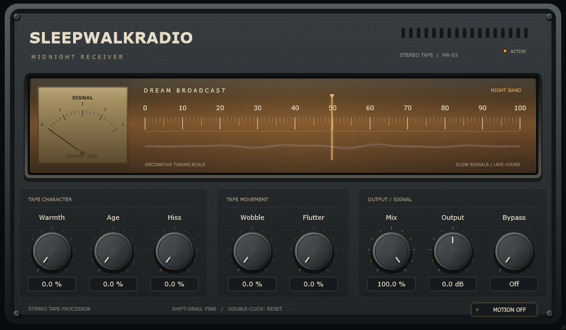

# SleepwalkRadio

**1.0.0-rc.1 ? release candidate, not a verified stable release.**

SleepwalkRadio is a Windows x64 VST3 tape effect: warm saturation, linked stereo wow/flutter, aged tone, independent hiss, aligned dry/wet blending and Output trim, inside the scalable Midnight Receiver interface. All eight controls support automation, editable values, keyboard adjustment and reset. Display motion is optional. Default settings are neutral apart from the reported delay. No factory presets are included.



## Install and use

Requires Windows 10 or newer on x64 and an x64 VST3-compatible DAW. No specific DAW is certified yet. Python, Visual Studio, JUCE and CMake are not required to use the plugin. The C++ runtime is statically linked. These builds are unsigned.

Close your DAW, run `SleepwalkRadio-1.0.0-rc.1-Windows-x64-Setup.exe` and approve the administrator prompt. The complete bundle goes to `C:\Program Files\Common Files\VST3\SleepwalkRadio.vst3`. Rescan plugins, then insert SleepwalkRadio on an audio track. Uninstall through Windows Installed Apps with your DAW closed.

For manual installation, extract `SleepwalkRadio-1.0.0-rc.1-Windows-x64-VST3.zip` and copy the entire `SleepwalkRadio.vst3` folder to that destination (administrator rights may be required), or a custom VST3 directory supported by your host. To remove a manual installation, delete only this plugin's bundle. See [INSTALL.txt](packaging/INSTALL.txt).

Start with low Warmth/Wobble/Flutter and raise Age for softer highs. Hiss is independent. Use Output to loudness-match; gain can exceed full scale. Bypass On returns aligned unity dry, while Off enables processing. Shift-drag adjusts finely, double-click resets, and clicking a value allows text entry. Tab and arrow keys operate controls; Space toggles Bypass.

Native DAW playback, automation/session recall, listening quality, actual Windows scaling and clean-machine install/uninstall remain **UNVERIFIED**. The standalone executable is built for development but is not packaged as production-ready. See [release notes and manual QA gates](RELEASE_NOTES.md).

## Troubleshooting

- Plugin missing: use an x64 VST3 host, check its scan paths, copy the whole bundle and rescan. Do not rename the inner binary or copy it alone.
- Installation denied: the standard system folder requires administrator rights. A host-supported custom VST3 path is an alternative for the portable package.
- Update/uninstall fails: close hosts using the plugin and retry. Do not delete unrelated files in the VST3 directory.
- Audio seems delayed: fixed latency is 337 samples at 48 kHz. Enable host delay compensation; this is not a zero-latency monitoring effect.
- Default sounds unchanged: this is intentional. Raise the character/movement controls; verify Bypass is Off and Mix is above zero.
- Loudness or clipping: reduce Output/input level and compare at matched loudness. Warmth compensation depends on signal level.
- Motion is distracting: choose Motion Off; sound and parameter editing are unaffected.
- Security warning: this candidate has no publisher signature. Verify checksums and source; do not disable security protections.

## Build prerequisites

- Windows 10 or newer, x64.
- Visual Studio 2019 16.11 Build Tools (or a compatible newer Visual Studio), with Desktop development with C++, MSVC v142, and Windows SDK 10.0.19041.0 or newer.
- CMake 3.22 or newer; verified setup uses 3.31.6. C++17 is required.
- Git and network access for first dependency download. Python is optional, used below to install a project-local CMake.
- JUCE 8.0.12, pinned to commit `29396c22c93392d6738e021b83196283d6e4d850` in CMake. No moving branch is used.

From the project root in PowerShell, with CMake on PATH:

```powershell
cmake -S . -B build -G "Visual Studio 16 2019" -A x64
cmake --build build --config Release --parallel 4
ctest --test-dir build -C Release --output-on-failure
```

For Visual Studio 2022, use `-G "Visual Studio 17 2022"` in a fresh build directory. It has not been tested here. CMake downloads the pinned JUCE commit into the build tree by default. For an offline configuration, supply an existing checkout of that exact commit using `-DFETCHCONTENT_SOURCE_DIR_JUCE="C:/path/to/JUCE"`.

Exact setup used on this machine (the bundled CMake 3.20 is too old):

```powershell
python -m pip install --target .tools/cmake-python cmake==3.31.6
git clone --depth 1 --branch 8.0.12 https://github.com/juce-framework/JUCE.git .deps/JUCE
git -C .deps/JUCE rev-parse HEAD
$cmake = ".\.tools\cmake-python\cmake\data\bin\cmake.exe"
$ctest = ".\.tools\cmake-python\cmake\data\bin\ctest.exe"
& $cmake -S . -B build -G "Visual Studio 16 2019" -A x64 -DFETCHCONTENT_SOURCE_DIR_JUCE="$pwd/.deps/JUCE"
& $cmake --build build --config Release --parallel 4
& $ctest --test-dir build -C Release --output-on-failure
```

Verify the printed JUCE commit matches the pin above. Dependencies, tools, build outputs, and binaries are ignored; do not commit them.

## Run and test

Standalone application:

```powershell
& ".\build\SleepwalkRadio_artefacts\Release\Standalone\SleepwalkRadio.exe"
```

Choose the desired audio device and input in its audio settings. JUCE's standalone wrapper can mute input initially to avoid feedback; enable input deliberately with a suitable routing/headphone setup. Actual audio-device playback and listening are separate manual checks.

VST3 bundle:

```text
build/SleepwalkRadio_artefacts/Release/VST3/SleepwalkRadio.vst3
```

Add the parent VST3 directory to your DAW's scan paths, or copy the **whole .vst3 folder** to `%CommonProgramFiles%\VST3` (may require administrator permission). Rescan, then insert SleepwalkRadio as an audio effect. The build does not install it automatically. Standalone success alone does not establish VST3 or DAW compatibility.

CTest `Phase1` retains parameter/state/editor regressions and checks exact neutral samples after the reported latency at every Mix setting. The old assertion that all parameters leave audio unchanged is deliberately replaced by DSP checks. It writes `build/editor-preview.png` for visual inspection.

CTest `Phase2DSP` covers mono/stereo, 44.1/48/88.2/96/192 kHz, blocks of 0/1/32/64/128/256/512/1024/2053 samples, extremes, rapid automation, silence, reset, deterministic noise, channel independence, stereo coherence, block partition invariance, Mix/Output/bypass, state recall, finite output, and a 60-second stereo 192 kHz stress run. It measures pitch movement, harmonics, tone response, folded-harmonic alias reduction and processing time. Test-only C++ allocation interception checks callback allocation; it is not a general OS/malloc/lock profiler.

Run focused DSP checks with `ctest --test-dir build -C Release -R Phase2DSP --output-on-failure`, then the full suite using the commands above. Use CTest so generated files stay in the ignored build directory. Numerical checks do not establish subjective sound quality or DAW compatibility.

## Midnight Receiver interface

Original JUCE vector artwork: charcoal brushed-metal enclosure, recessed amber tuning glass, engraved decorative scale, output-level needle, subdued lavender signal trace, corner screws, vents, and dark machined rotary knobs. The supplied radio/hifi photos informed materials and proportions; no photograph, brand logo, external image asset or new UI framework is embedded.

The eight controls are visually grouped left to right:

- **Tape Character:** Warmth, Age, Hiss.
- **Tape Movement:** Wobble, Flutter.
- **Output / Signal:** Mix, Output, Bypass.

Bypass is a two-position rotary switch with readable Off/On values. Off means the tape engine is active; On means aligned dry audio. The header pilot confirms ACTIVE/BYPASS. Names, parameter registration order and DSP mappings are unchanged. All controls use APVTS slider attachments, editable value fields, double-click default reset, Shift-drag fine adjustment and explicit keyboard gestures. Tab follows the visual order; arrows adjust and Space toggles Bypass. Focus has an amber ring. Tooltips describe each control.

Base editor: **960 x 560 logical pixels**, proportional resizing from **768 x 448 to 1440 x 840**. Layout uses one logical coordinate system and vector drawing, with an independently cached faceplate and a separate moving overlay. JUCE handles device scaling; no screenshot is stretched as the interface. Automated renders exercise 100%, 125%, 150%, and 200% pixel scales, plus minimum/maximum layouts; actual Windows display-scale/DAW window behavior still requires manual checking.

The meter uses a lock-free, approximate snapshot of actual output peak level, published only while a visualization observer is registered. UI code never reads DSP buffers. The decorative needle drift uses Wobble/Flutter amounts and UI-only oscillators, not the exact tape delay trajectory. The trace is stylized level-driven feedback, not an oscilloscope or spectrum analyser. Tuning numbers are explicitly labelled decorative, not radio frequencies.

Animation is capped at 30 Hz while active. Idle/hidden editors poll at 4 Hz without continuously repainting the panel; the timer is destroyed when the editor closes. **Motion Off** stops the timer and audio-level publication while keeping every audio control functional. This per-instance UI preference survives editor reopening, but is deliberately not a ninth host parameter and is not serialized into schema 1. No audio-engine changes or latency changes were made for the interface.

`Phase3Editor` tests all eight controls, text/keyboard automation gestures, state restoration, isolation between instances, resize bounds, DPI render sizes, motion-off behavior, repeated reopening and sample-exact audio with/without metering. Images are written under `build/receiver-*.png`. Run just this target with `ctest --test-dir build -C Release -R Phase3Editor --output-on-failure`.

Phase 3 verification: Windows x64 Release VST3 and standalone builds passed; all three CTest suites passed (908,353 checks). See the [saved log](docs/phase-reports/Phase3-tests.txt) and [actual JUCE render](docs/phase-reports/MidnightReceiver.png). Native DAW, Windows display-scale interaction and listening checks remain pending.

## Tape engine

Signal path: input -> 2x FIR-oversampled saturation -> shared variable-delay transport -> two-pole tone -> hiss -> linear dry/wet -> Output -> aligned bypass crossfade.

| Control | DSP mapping |
|---|---|
| Warmth | Normalized `w`: drive `1 + 3w²`, tanh with compensation `(1 + 0.5w)/drive`, blended by `w` with an aligned clean path. Zero is exactly clean. |
| Wobble | Up to +/-4 ms delay deviation, scaled quadratically. Weighted 0.23/0.371/0.073 Hz oscillators plus smooth seeded random wandering; one transport for both channels. |
| Flutter | Up to +/-0.15 ms deviation, scaled quadratically, weighted 6.31 and 9.73 Hz oscillators. |
| Age | Two cascaded one-pole lowpasses; cutoff moves exponentially from 18 kHz to 2.5 kHz (capped below Nyquist). Crossfade from clean to filtered by Age. Zero is exactly clean; bass/DC preserved. |
| Hiss | Seeded xorshift noise shaped by 10 kHz lowpass and 1.2 kHz highpass; amplitude `0.004h²`. Independent of Age; identical noise in both channels maintains the centre image. |
| Mix | Linear interpolation between latency-aligned original audio and processed audio. Zero excludes all wet processing and hiss. |
| Output | -12 to +12 dB after Mix; applies at Mix zero too. |
| Bypass | 10 ms crossfade to latency-aligned original audio, ignoring Output. Host bypass callback uses the same path and keeps histories running. |

All controls use sample-by-sample linear ramps: 150 ms for Wobble/Flutter depth, 10 ms for Bypass, 30 ms otherwise (Output ramps in dB). Restored values follow those ramps while processing; prepare/reset starts at current values and clears histories. Parameters are sampled atomically once per host block, so host automation is block-timed rather than sample-offset automation. Large or changing host blocks are processed in preallocated chunks of at most 1024 samples without callback allocation.

The transport uses bounded four-point cubic interpolation. Dry and bypass always retain the same fixed delay as neutral wet: `ceil(sampleRate * 0.006) + oversamplingLatency` samples. The exact integer value is set in `prepareToPlay` and reported to the host; changing knobs never changes it. Default and neutral audio are bit-exact after this delay. Nonzero modulation intentionally moves wet relative to dry, so intermediate Mix settings can produce chorus/comb coloration. The FIR oversampling filter adds some high-frequency coloration when Warmth is enabled. No zero-latency bypass or live-monitoring mode is provided.

Measured latency: 314 samples at 44.1 kHz (7.120 ms), 337 at 48 kHz (7.021 ms), 579 at 88.2 kHz (6.565 ms), 625 at 96 kHz (6.510 ms), and 1201 at 192 kHz (6.255 ms). The oversampling stage accounts for 49 samples; the remaining delay provides room for bounded tape motion.

Release characterization measured 97.8/78.8 dB less folded third harmonic than native-rate tanh at 44.1/48 kHz for a 10 kHz, 0.8-peak test tone at maximum Warmth. This supports the 2x oversampling choice but is not a broadband alias-free guarantee. At maximum Warmth, measured 1 kHz sine RMS gain changes were +3.44 dB at 0.05 peak, +1.73 dB at 0.25 peak, and -4.59 dB at 0.8 peak: compensation is approximate and level-dependent. Maximum Hiss measured -56.4 dBFS RMS at 48 kHz. Loudness-match listening comparisons. See the [saved test report](docs/phase-reports/Phase2-tests.txt) for results.

The declared finite tail is 50 ms for buffer/filter decay. Hiss can continue during silence while the host processes the plugin; it does not request an infinite tail. Reset clears delay/filter/oversampling histories and restarts fixed, independent noise/transport seeds. State saves parameters, not the evolving tape position, random generator position, or filter histories. Repeated renders from the same reset are reproducible; arbitrary session resume is not a promise of sample-identical modulation/noise.

Nonfinite input becomes zero. A +/-16 safety bound on input/output prevents pathological host samples from poisoning histories; normal audio is not peak-normalized or limited to full scale. Output boost can exceed 0 dBFS. The callback has no file I/O, locks, allocation, or logging. Prepare allocates; reset must be called according to the host lifecycle, not concurrently with processing.

## Stable identity and state

Product/target: `SleepwalkRadio`; manufacturer code: `Swrd`; plugin code: `Swr1`; bundle ID: `local.sleepwalkradio.effect`. The manufacturer metadata `SleepwalkRadio` is a project-local technical label, **not a user-supplied company identity**. Preserve these values in later phases; changing them can break host session recall. MIDI input/output are disabled, VST3 category is `Fx`, and only matching mono/stereo buses are accepted. Double precision processing is not advertised. Numeric host/Windows product version is 1.0.0; package version is 1.0.0-rc.1; parameter IDs, ranges, defaults, version hints, and schema remain compatible with Phase 1. Old nondefault sessions activate their corresponding effects.

| ID | Range | Default | Parameter version hint |
|---|---|---|---|
| warmth | 0–100 % | 0 | 1 |
| wobble | 0–100 % | 0 | 1 |
| flutter | 0–100 % | 0 | 1 |
| age | 0–100 % | 0 | 1 |
| hiss | 0–100 % | 0 | 1 |
| mix | 0–100 % | 100 | 1 |
| output | -12–12 dB | 0 | 1 |
| bypass | boolean | false | 1 |

APVTS is authoritative. Bypass is also returned by `getBypassParameter()`. The editor uses parameter attachments, with gestures for mouse, text, reset, keyboard, and bypass editing. Tab focuses controls, arrow keys adjust, Shift-drag provides fine velocity adjustment, clicking values enables text entry, and double-click resets.

State uses JUCE binary XML with root `SleepwalkRadioState` and `schemaVersion="1"`. It is validated before replacement. Missing known parameters reset to their documented defaults. Wrong roots, absent/older/future schema versions, duplicate or unknown parameter IDs, missing/non-numeric/nonfinite/out-of-range values, nonboolean bypass, malformed or oversized (>1 MiB) payloads are rejected without applying any settings. No unversioned legacy format exists. Host state save/restore uses APVTS locks outside the audio callback; do not call serialization from the audio thread. Parameter restoration is validation-atomic, not a promise of sample-atomic multi-parameter transitions.

## Manual host checklist

- Record DAW name/version, audio device, sample rate, block size, and plugin build.
- Scan and load the VST3 on an audio track; check supported mono and stereo operation.
- Null-test the default/neutral configuration with host latency compensation, including all Mix settings and settled bypass.
- Listen at low/medium/high settings on vocals, guitars, synths, bass, drums and a full mix; loudness-match before judging saturation.
- Check Wobble/Flutter on sustained notes, stereo imaging, transients, high-frequency aliasing, and pitch/bypass automation transitions.
- Check Hiss zero on silence, independence from Age, Mix zero excluding effects/noise, and Output still applying at Mix zero.
- Move every control, enter text, reset, and use keyboard/fine adjustment.
- Check native Windows 100/125/150/200% scaling, minimum/maximum resizing, focus and screen-reader behavior.
- Check animation on/off, idle/hidden editors and multiple instances for CPU use and audio interruptions.
- Write/read automation for each parameter and check editor synchronization.
- Save the session with nondefault settings, close the DAW, reopen, and verify every value.
- Toggle host/plugin bypass, restart transport, and repeatedly open/close the editor.
- Check standalone device playback separately. Record listening results; do not infer them from tests.

## Packaging from source

After a successful Release build and full CTest run, install Inno Setup 6 and run:

```powershell
python packaging/package.py
```

Packaging uses `.deps/JUCE` at the pinned revision. In a source archive this directory is included; configure with `-DFETCHCONTENT_SOURCE_DIR_JUCE="$pwd/.deps/JUCE"`. Python is a packaging tool only. The script checks version/identity, builds the actual installer, writes portable and matching source ZIPs into `dist/`, tests ZIP integrity, verifies binary hashes and creates `SHA256SUMS.txt`. It excludes build tools, Git metadata and generated outputs from source packages. Keep the source ZIP available alongside binaries. Installer runtime testing is a separate required gate.

JUCE/Windows metadata use numeric 1.0.0 because JUCE's numeric version encoder does not accept semantic prerelease suffixes. CMake's `SLEEPWALKRADIO_RELEASE_VERSION`, installer display text, filenames, documentation and any candidate tag use **1.0.0-rc.1**. No stable `v1.0.0` tag is authorized until the manual release gates pass.

## Licensing

Copyright (c) 2026 scryingorb. SleepwalkRadio is released under **AGPL-3.0-only**, with no warranty. See [LICENSE](LICENSE) and [third-party notices](THIRD_PARTY_NOTICES.md). JUCE is used under its AGPLv3 option. Matching project and pinned JUCE source is included in the source archive; distribute that archive alongside binary packages. Original UI artwork is included under the project license. No supplied reference photographs are embedded.

See [PROJECT_STATUS.md](PROJECT_STATUS.md) for actual verification results and pending gates, and [the plan](docs/SleepwalkRadio_Plan.md) for later phases.
